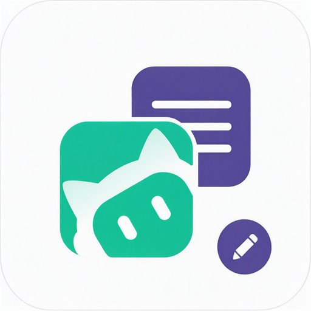

<p align="center">
  
</p>

<h1 align="center">WorkBuddy Task Manager</h1>

<p align="center">给 AI Agent 用的 WorkBuddy 本地任务管理技能</p>

<p align="center"><sub>repo / slug: <code>workbuddy-conversation-manager</code></sub></p>

<p align="center">
  <a href="https://github.com/HuaHua-Technophile/workbuddy-conversation-manager/releases"></a>
  <a href="https://www.python.org/"></a>
  <a href="#"></a>
  <a href="LICENSE"></a>
</p>

一个给 AI Agent 用的技能：管理本机 **WorkBuddy** 的任务与分组——10 项体检、筛选、按完整任务历史两步式重命名、跨分组迁移（连同记忆和产出）、整库备份与回滚。

> A portable agent skill for managing local **WorkBuddy** tasks: doctor, list/filter, two-step rename from full transcripts, move between groups with memory and outputs, backup & rollback.

---

## 为什么需要它

WorkBuddy 侧栏标题通常只取任务开头，长任务真正的落点往往在中后段：

- `在本机把工具包里的旧镜像换成新镜像`，通读后才发现真正要处理的是驱动兼容和启动项；
- `请根据今天的记录整理一下`，实际结论是三个分组该合并、两条任务该改名。

rename 只改标题还不够。把一条任务从 A 分组移到 B 分组时，WorkBuddy 的正文路径由 `cwd` 推导，数据库、JSONL、同名子目录、侧栏快照、记忆段落和产出文件都要一起处理，否则应用重启后可能读不到、记忆丢失或链接失效。

这个技能把「读完整历史 → 生成准确标题 → 安全写回」和「改归属 + 搬全套文件」变成可重复、可回滚的流程，并默认先干跑、按对象备份。

## 亮点

- **两步式重命名**：`rename --export` 导出完整历史，Agent 生成 `titles.json`，`rename --import` 写回；默认只打印计划，`--apply` 才落盘。
- **自动分片**：按字数做 LPT 均衡分片，大批量任务可以交给多个子智能体并行处理。
- **真迁移**：`move` 默认搬任务 JSONL、同名子目录、该任务写入的记忆段落与产出；旧路径留硬链接，历史链接不断。
- **10 项体检**：数据库、WAL、表结构、进程、任务文件、项目目录一致性、空目录、侧栏快照、标题一致性、备份。
- **安全兜底**：每条任务独立事务；失败只回滚该条；目标文件重名先备份；搬空的源目录自动清理。
- **可演练**：`--workbuddy-home` 指向数据库副本，和真库互不影响；写库前可以先跑一遍完整流程。

## 安装

技能是纯目录 + Python 标准库脚本，不需要 `pip install`。

```bash
git clone https://github.com/HuaHua-Technophile/workbuddy-conversation-manager.git
cd workbuddy-conversation-manager

python install.py                 # 装到 ~/.workbuddy/skills
python install.py --to ~/.qoder/skills
python install.py --targets all   # WorkBuddy / Qoder / .agents 三处都装
```

也可以直接复制技能目录：

```bash
cp -r skills/workbuddy-conversation-manager "$HOME/.workbuddy/skills/"
```

安装后验证：

```bash
python "$HOME/.workbuddy/skills/workbuddy-conversation-manager/scripts/workbuddy_sessions.py" doctor
```

## 快速开始

以下命令在已安装的技能目录执行（`cd ~/.workbuddy/skills/workbuddy-conversation-manager`）。

```bash
# 1. 体检
python scripts/workbuddy_sessions.py doctor

# 2. 看看有哪些任务
python scripts/workbuddy_sessions.py list --limit 20

# 3. 导出完整历史（大批量加 --shards 自动均衡分片）
python scripts/workbuddy_sessions.py rename --export --shards 6 --out ./wb-exp

# 4. 让 Agent 读 ./wb-exp/*.txt，产出 titles.json，然后先干跑
python scripts/workbuddy_sessions.py rename --import ./wb-exp/titles.json

# 5. 确认无误后落盘
python scripts/workbuddy_sessions.py rename --import ./wb-exp/titles.json --apply
```

`titles.json` 格式：

```json
[
  {"sid": "6ed7f61f", "new_title": "整理 WorkBuddy 任务标题与分类", "category": "系统"},
  {"session_id": "57cb405c-0997-47b8-bf97-d3fac97d42dc", "new_title": "把任务管理技能开源并部署笔记本"}
]
```

`sid` 支持完整 UUID 或前 8 位；`new_title` 可不带前缀，`category` 会自动补成 `[分类] 标题`。标题默认长度 **20–30 字**，可用 `--min-title-len` / `--max-title-len` 调整到 **10–30**。

## 迁移任务

```bash
# 默认：改归属 + 搬任务 JSONL/子目录 + 搬记忆与产出
python scripts/workbuddy_sessions.py move --session 6ed7f61f --to "X:/赞大拇指"

# 只要元数据，不搬记忆与产出
python scripts/workbuddy_sessions.py move --session 6ed7f61f --to "X:/赞大拇指" --metadata-only

# 目标分组不存在时，用首个迁入任务创建分组（目录需已存在）
python scripts/workbuddy_sessions.py move --session 6cd29df7 --to "D:/VMs" --create-space
# 确认允许新建目录
python scripts/workbuddy_sessions.py move --session 6cd29df7 --to "D:/VMs" --create-space --allow-missing
```

搬空的源项目目录默认自动删除，`--keep-orphans` 可保留；删除清单会写入本次迁移的 `batch.json`。

## 命令总览

| 命令 | 用途 | 写库 |
|---|---|---|
| `doctor` | 10 项体检：数据库、WAL、表结构、进程、任务文件、目录一致性、空目录、快照、标题一致性、备份 | 否 |
| `list` | 关键词 / cwd / 时间 / 区域 / 账号筛选 | 否 |
| `rename --export` | 导出完整历史，按字数 LPT 自动分片 | 否 |
| `rename --import` | 导入 `titles.json`；默认干跑，`--apply` 落盘 | 是 |
| `move` | 迁移任务/分组；默认连记忆、产出和任务文件一起搬 | 是 |
| `backup` | 整库快照，默认保留最近 10 份 | 否 |
| `rollback` | 按迁移 manifest 单条/整批回滚 | 是 |

**不做**：不删除任务、不改任务正文、不重建索引、不操作云端或其他设备的任务。

## 安全设计

- **默认干跑**：`rename --import` 不加 `--apply` 只打印 `[PLAN]`。
- **按对象备份**：迁移每条一份 manifest；重命名按批次备份数据库、JSONL 和两个账号的侧栏快照。
- **每条独立事务**：某条失败只影响它自己，其余继续；失败会说明回滚是否成功。
- **热写可选**：允许 WorkBuddy 运行中写入；要硬性拦截加 `--require-closed`（退出码 3）。
- **副本演练**：`--workbuddy-home` 可指向数据库副本，与真库互不影响。
- **不覆盖**：目标已有同名文件先备份；备份目录自动去重。

## 文档

| 文件 | 内容 |
|---|---|
| [`SKILL.md`](skills/workbuddy-conversation-manager/SKILL.md) | 技能主文档：完整命令、工作流、安全规则 |
| [`references/workbuddy-storage.md`](skills/workbuddy-conversation-manager/references/workbuddy-storage.md) | 表结构、路径编码、标题存储、验证 SQL、已知坑 |
| [`references/rename-classify.md`](skills/workbuddy-conversation-manager/references/rename-classify.md) | 两步式重命名、LPT 分片、子智能体模板 |
| [`references/cases.md`](skills/workbuddy-conversation-manager/references/cases.md) | 70 条任务重命名实测与踩坑 |
| [`references/install.md`](skills/workbuddy-conversation-manager/references/install.md) | 三端安装与验证 |
| [`CHANGELOG.md`](skills/workbuddy-conversation-manager/CHANGELOG.md) | 版本记录 |
| [`PUBLISHING.md`](skills/workbuddy-conversation-manager/PUBLISHING.md) | 各平台发布状态、CLI 发布与 CI 自动化 |

## 环境要求

- Python 3.9+
- WorkBuddy（Windows），已登录并产生过任务
- 对 `~/.workbuddy` 的读写权限

## 已知限制

- 仅支持 **Windows**。
- 只操作本机 `~/.workbuddy` 的本地任务。
- 不删除任务、不改任务正文、不重建搜索索引。
- 默认迁移会搬记忆与产出；只要元数据时加 `--metadata-only`。

## 发布

- **GitHub Release**：latest 见 [Releases](https://github.com/HuaHua-Technophile/workbuddy-conversation-manager/releases)。
- **SkillHub**：[workbuddy-conversation-manager](https://skillhub.cn/skills/user_3c4d2464/workbuddy-conversation-manager)（1.4.2 审核中）。
- **WorkBuddy 开放平台**：手动提交 `-dir` 包；该平台暂无 API / CLI / CI。
- 仓库已接入 `.github/workflows/release.yml`：push `v*` tag 自动构建并发布 GitHub Release，配置 `SKILLHUB_KEY` 后可同步发布 SkillHub。

## License

[MIT](LICENSE)
